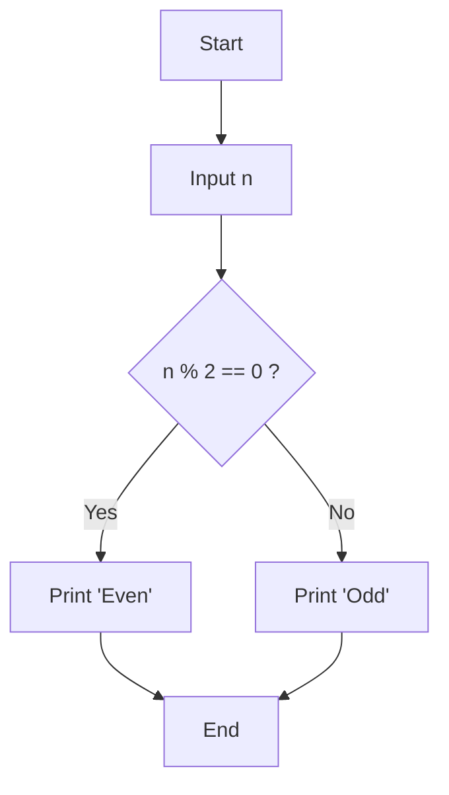

# Odd or Even Number Program

## Concept
A number is classified using the **modulo operator (`%`)**, which returns the remainder of a division.

- If `n % 2 == 0` → the number is **even**.
- If `n % 2 != 0` → the number is **odd**.

This works because any integer divided by 2 leaves a remainder of either 0 or 1.

## Flowchart


## Code
```c
#include <stdio.h>

int main() {
    int n;

    printf("Enter an integer: ");
    scanf("%d", &n);

    if (n % 2 == 0) {
        printf("%d is Even\n", n);
    } else {
        printf("%d is Odd\n", n);
    }

    return 0;
}
```

## Key Points
- `%` is the **modulus operator**, only valid on integer types in C.
- Works correctly for negative numbers too (e.g., `-4 % 2 == 0`).
- This is the simplest example of a **conditional (branching) statement**.
