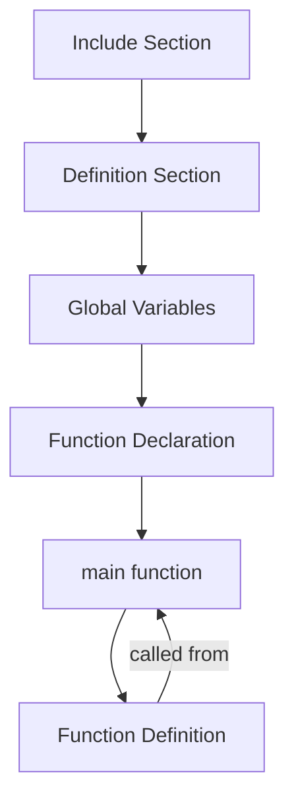

# Structure of a C Program

The compiler doesn't strictly require all of them.

---

## 1. Include Section

Brings in pre-written library code so you can use functions like `printf()` and `scanf()` without writing them yourself.

``` c
#include <stdio.h>   // angle brackets = system/standard library
#include "myheader.h" // quotes = your own header file
```

**Why it matters:** Without this, the compiler has no idea what `printf` even is.

---

## 2. Definition Section

Defines constants used throughout the program — values that don't change.

```c
#define PI 3.14159
```

**Why it matters:** Using a named constant instead of scattering `3.14159` everywhere makes code easier to read and update — change it in one place, it updates everywhere it's used.

`#define` is a **preprocessor directive** — meaning it doesn't run as actual code when your program executes. Instead, before compilation even starts, a step called the **preprocessor** scans your file and does a plain text find-and-replace wherever it sees the defined name.

```c
#define PI 3.14159

int main() {
    float area = PI * 5 * 5;
    return 0;
}
```

before compiling, the preprocessor rewrites the code to:

``` C
int main() {
    float area = 3.14159 * 5 * 5;
    return 0;
}
```

so the syntax is: `#define text_to_replace text_to_be_replaced_with` 

N.B. no ; is to be used at the end of `#define` 
N.B. PI is not a real variable, it doesn't exist in memory.
## 3. Global Variable Section

Variables declared outside any function. Accessible from every function in the file.

```c
int totalCount;  
```

---

## 4. Function Declaration (Prototype) Section

A "heads-up" to the compiler: *this function exists, here's its name, return type, and parameters* — but not what it actually does yet.

```c
int add(int a, int b);  
```

**Why it matters:** `main()` is usually written *before* the actual function code. The declaration lets the compiler know the function is valid to call in `main()`, even though the real code appears later in the file (Section 6).

---

## 5. Main Function Section

The entry point of the program — execution always starts here, regardless of where other functions are physically placed in the file.

```c
int main() {
    int result = add(5, 3);
    printf("Result: %d", result);
    return 0;
}
```

**Why it matters:** Every C program has exactly **one** `main()`. Nothing runs until this function executes.

---

## 6. Function Definition Section


```c
int add(int a, int b) {
    return a + b;   // actual logic lives here
}
```

**Why it matters — Declaration vs. Definition (Section 4 vs. Section 6):**

| | Section 4: Declaration | Section 6: Definition |
|---|---|---|
| What it is | Signature only | Full implementation |
| Purpose | Tells compiler the function exists | Tells compiler what the function *does* |
| Has a body `{ }`? | No | Yes |
| Example | `int add(int a, int b);` | `int add(int a, int b) { return a + b; }` |

---

## Putting It All Together — Full Example

```c
#include <stdio.h>              // 1. Include

#define PI 3.14159              // 2. Definition

int totalCount;                 // 3. Global variable

int add(int a, int b);          // 4. Function declaration

int main() {                    // 5. Main function
    int result = add(5, 3);
    printf("Result: %d\n", result);
    return 0;
}

int add(int a, int b) {         // 6. Function definition
    return a + b;
}
```

---

## Compile-Time Order (Diagram)



> Note: The declaration in Section 4 is what makes the arrow from `main()` back down to the definition in Section 6 possible — without it, the compiler would complain that `add()` is "undeclared" when it's called inside `main()`.
